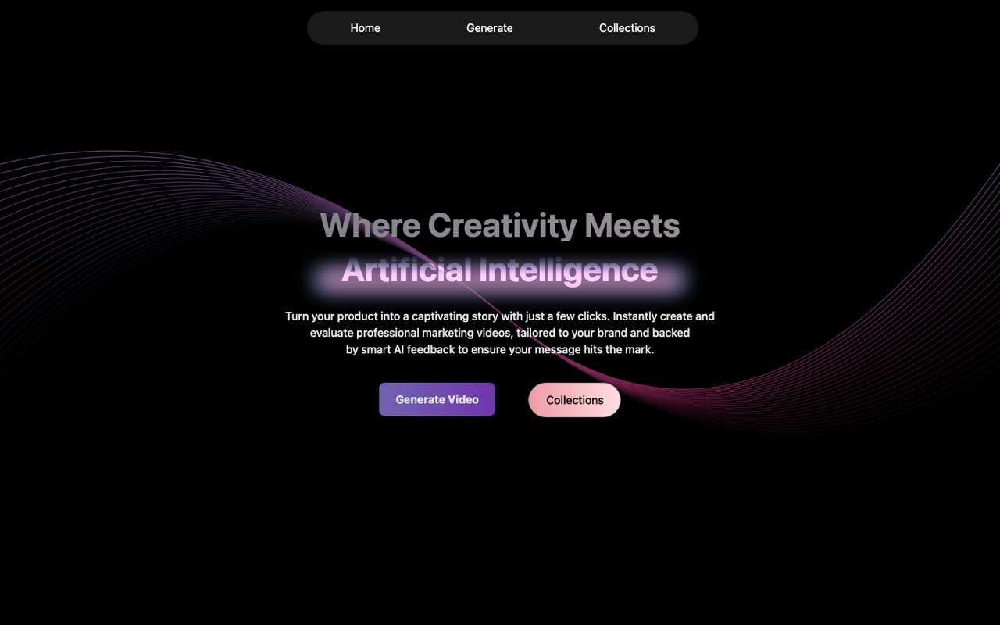

# Video Generation & Scoring

Generate marketing videos for a product and score them against brand guidelines with AI. Built by **Team Chill Guys** for the OnlineSales.ai hackathon (December 2024).

**Live demo:** https://videog-generating-and-scoring-api.vercel.app



## What it does

1. **Input:** product name, tagline, brand colours, call-to-action text, logo and a product image or video. Brand colours are named automatically through The Color API.
2. **Prepare assets:** uploads go to Cloudinary, and product backgrounds are removed by our [background removal API](https://github.com/akshatttt321/bgremove).
3. **Generate:** builds a marketing video in a chosen visual style: hand-drawn, handmade 3D, realistic, 2D art, pop or digital engraving. Users can add extra guidelines and get an email when the video is ready.
4. **Score:** Gemini 2.0 Flash first writes a detailed rubric from the scoring criteria, then scores the video step by step with justifications. A second model (Gemini 1.5 Flash, JSON mode) turns that into a typed score.
5. **Review:** each video gets a dashboard page, and every generated video is kept in a catalogue.

## Scoring criteria

Each criterion is given a maximum number of points in the request:

- Background / foreground separation
- Brand guideline adherence
- Creativity and visual appeal
- Product focus
- Call to action
- Audience relevance

The API returns the score for each criterion, a `total_score`, and video metadata (file size, duration, resolution).

## Tech stack

**Front end:** React 18 · Vite · React Router · Tailwind CSS · GSAP · Cloudinary · Axios
**Scoring service:** Python · FastAPI · Pydantic · Google Generative AI (Gemini)

## Repository layout

```
Video-Scoring/            React front end (deployed on Vercel)
  src/components/         Home, InputForm, Dashboard, Catalogue, Navbar
src/                      Python scoring service
  models/schemas.py       request and response models
  services/video_scorer.py  rubric + scoring with Gemini
```

## Run the front end

```bash
cd Video-Scoring
npm install
npm run dev
```

The scoring service needs `GEMINI_API_KEY` in the environment.

## Team

[Akshat Bhriguvanshi](https://akshatttt321.github.io) (front end, integration) · [Kan1shak](https://github.com/Kan1shak)
